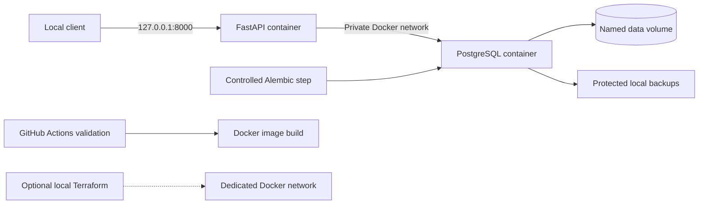

# cloud-deployment-platform

A beginner-friendly DevOps portfolio project: a task management API with persistent
PostgreSQL storage, containers, automated checks, backup recovery, and local Infrastructure as Code.

**Current status: Phase 1 complete. The application and deployment are not implemented yet.**
See [PROGRESS.md](PROGRESS.md) for actual checks and the remaining phases.

The project addresses a practical problem: delivering a small API repeatably, proving
that its data survives restarts, and understanding how to diagnose and recover failures.
It demonstrates Python backend development, Linux, Docker, CI, database operations,
secrets handling, and Terraform without requiring AWS credentials or cloud spending.

## Planned architecture



Technology: Python 3.12+, FastAPI, PostgreSQL, SQLAlchemy 2, Alembic, Pydantic,
Pytest, Ruff, Docker Compose, GitHub Actions, and Terraform. Dependency ranges are
declared in `pyproject.toml`; reproducible resolved dependencies and explicit container
versions will be established in later phases before runtime verification.

## Project structure

```text
cloud-deployment-platform/
├── .github/workflows/       # Phase 4 workflow
├── app/                    # Phase 2 API package
├── docs/
│   ├── architecture.md
│   ├── interview-guide.md
│   └── troubleshooting.md
├── infra/terraform/        # Phase 6 optional local network
├── migrations/versions/    # Phase 2 Alembic revisions
├── scripts/                # Phase 5 operational scripts
├── tests/
│   ├── integration/
│   └── unit/
├── .dockerignore
├── .env.example
├── .gitattributes
├── .gitignore
├── PROGRESS.md
├── README.md
└── pyproject.toml
```

## Prerequisites and Phase 1 setup

Use Ubuntu WSL2 with Python 3.12+, Git, and Docker Desktop WSL integration.
Terraform is optional until Phase 6. No AWS account is needed.

```bash
git --version
python3 --version
docker --version
docker compose version
docker info
python3 -m venv .venv
source .venv/bin/activate
```

If Python's venv module is missing on Ubuntu, install `python3-venv` using apt.
If Docker cannot connect, start Desktop and check WSL integration; do not make the
Docker socket world-writable. Terraform installation guidance is in
[infra/terraform/README.md](infra/terraform/README.md).

Phase 2 will install the project using `python -m pip install -e '.[dev]'`.
Phase 1 only verifies the scaffold and creates a virtual environment; it does not
install dependencies or start a placeholder API.

## Environment variables (planned contract)

Copy `.env.example` to `.env` before the Compose phase and choose a fresh local password.
Keep the password in `DATABASE_URL` consistent with `POSTGRES_PASSWORD`.
URL-encode special characters in the URL password. Never commit `.env`.

| Variable | Purpose | Example |
| --- | --- | --- |
| `POSTGRES_DB` | Database initialized by PostgreSQL | `tasks` |
| `POSTGRES_USER` | Local database role | `tasks_app` |
| `POSTGRES_PASSWORD` | Local development password | Fake value in `.env.example` |
| `DATABASE_URL` | SQLAlchemy psycopg URL | Compose hostname `db`, port `5432` |
| `LOG_LEVEL` | Application log verbosity | `INFO` |

The initial local PostgreSQL role will need schema-management privileges for migrations.
A future production deployment should separate migration and application roles.

## API and testing roadmap

Phase 2 adds `GET /health`, `GET /ready`, `GET /tasks`, `GET /tasks/{id}`,
`POST /tasks`, `PUT /tasks/{id}`, and `DELETE /tasks/{id}`.
Tasks have id, title, description, completed, created_at, and updated_at fields.
No endpoints can be exercised yet. Planned commands after implementation:

```bash
curl -f http://localhost:8000/health
curl -f http://localhost:8000/ready
curl -f -X POST http://localhost:8000/tasks \
  -H 'Content-Type: application/json' \
  -d '{"title":"Verify deployment","description":"Portfolio demo","completed":false}'
curl -f http://localhost:8000/tasks
python -m pytest -m unit
python -m pytest -m integration
ruff check .
```

Integration tests must use a disposable PostgreSQL database. There are no tests
yet; an empty test suite is not evidence of a working application.

## Container lifecycle (available in Phase 3)

```bash
docker compose up -d --build
docker compose ps
docker compose logs --tail=100
docker compose down
```

`down` removes the stack's containers and managed networks while retaining named
volumes. `docker compose down -v` also deletes named volumes and their PostgreSQL
data. That destructive command requires deliberate approval and a recovery plan.
The repository currently has no Compose file or Dockerfile.

## Remaining operational phases

Phase 4 adds CI: lint, unit tests, PostgreSQL migrations and integration tests,
Docker image build, and Terraform formatting/validation. No real GitHub Actions
run has been checked. Optional GHCR publishing will use minimal permissions and
trusted events, separately from validation. Deployment to AWS will remain manual.

Phase 5 adds structured logs, request IDs, duration, health checks, and
`scripts/backup.sh`, `scripts/restore.sh`, `scripts/verify.sh`. Backups will be checked
for nonzero size and restored in an isolated database, with sample record verification.
Protect backups, restrict access, and define retention; none will be committed.

Phase 6 adds the optional Docker network using Terraform. The Compose-only path
will remain usable. See [infrastructure notes](infra/terraform/README.md).

Phase 7 verifies the complete workflow and expands these instructions with actual
commands and evidence. Monitoring currently consists only of the documented design;
see [troubleshooting](docs/troubleshooting.md) and [architecture](docs/architecture.md).

## Security, future AWS approach, and limitations

The planned API is an unauthenticated local learning service. Bind it only to localhost.
Do not expose it to the Internet without authentication, TLS, rate controls, and review.
Production secrets belong in a managed secret store, never in Git or Docker images.
Ignored state and backup files still require protection on disk.

A future AWS proposal could use ECS/Fargate with an application load balancer, private
RDS PostgreSQL, Secrets Manager, and managed logs. This is a proposal, not executable
infrastructure. Obtain approval and estimate costs before creating cloud resources;
databases, load balancers, logs, and retained backups can continue incurring charges.
Cleanup must inventory resources and retained storage before deleting anything.

Known limitations: only the scaffold exists; no runtime, CI, backup, restore, or
Terraform validation has passed yet. There is no authentication, TLS, metrics platform,
or high availability. Future improvements include those controls, recovery drills,
dependency locking, and release promotion. Kubernetes, microservices, Redis, and a
frontend remain outside scope.

For interview explanations, read [docs/interview-guide.md](docs/interview-guide.md).
Be ready to explain why a volume is not a backup, why readiness differs from liveness,
why CI should not deploy untrusted changes, and why Terraform state must be protected.
